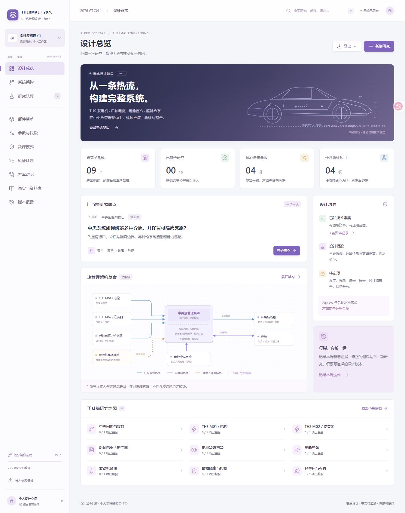
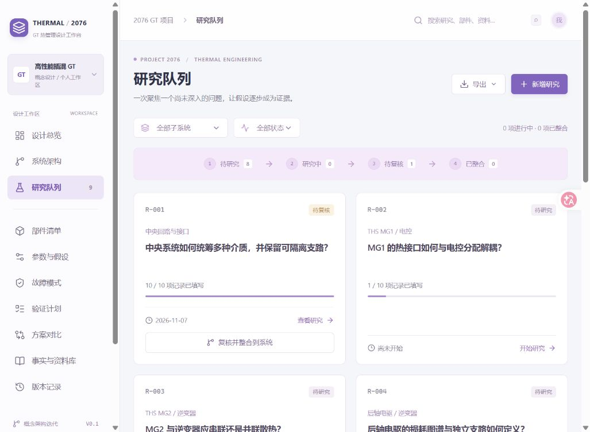

# 2076 GT · 热管理系统设计工作台

面向个人持续维护的中文概念设计工作区。围绕 THS MG1、MG2、后轴 200 kW 电机及其电控/逆变器，逐步研究中央热管理、电池冷媒直冷、座舱热泵、发动机余热、故障隔离和轻量化。

**这是研究记录与方案比较工具。** 热流图为功能架构草案；尺寸、损耗、温度、流量、布置和性能未确定时保留为待定项。200 kW 来自项目需求，额定/峰值及持续时间未定义，不能当作热负荷。

## 界面





## 使用方式

1. 从子系统队列选择一个尚未深入研究的问题，同时最多推进一项研究。
2. 记录架构、热流路径、关键取舍、潜在故障、验证方法、事实、假设、待定项、来源和结论。
3. 保存草稿，补齐后提交复核；审核通过再整合到系统并生成快照。
4. 分别维护热流路径、部件清单、参数表、故障模式、验证计划和方案比较。
5. 每周记录新增结果与版本，使用 JSON 完整备份和 Markdown 复盘导出。

技术事实应附原始资料及适用边界。设计假设与未经验证的推断单独记录。工作台不会自动开展研究或执行仿真、试验。

## 源码与线上数据

- 本仓库包含应用源码、初始研究框架、数据库迁移和界面截图。
- 已部署的 [Sites 工作台](https://gt2076-thermal-lab.xjc2680383389.chatgpt.site/) 使用原有私有访问策略；公开源码不改变站点访问权限。
- 线上研究记录按 Sites 用户身份隔离并保存在 D1，未导入公开仓库。截图仅展示首轮研究状态。
- `node_modules`、构建产物、本地数据库、环境文件、凭据和 QA 备份不纳入源码。

## 本地运行

需要 Node.js >= 22.13.0。使用锁文件安装依赖并构建：

```sh
npm run install:ci
npm run build
```

在项目根目录依次应用本地数据库迁移：

```sh
node --import ./scripts/sites-env.mjs ./node_modules/wrangler/bin/wrangler.js d1 execute DB --local --config dist/server/wrangler.json --persist-to .wrangler/state --file drizzle/0000_zippy_grey_gargoyle.sql
node --import ./scripts/sites-env.mjs ./node_modules/wrangler/bin/wrangler.js d1 execute DB --local --config dist/server/wrangler.json --persist-to .wrangler/state --file drizzle/0001_massive_sumo.sql
npm run dev
```

迁移仅首次或新增迁移时按顺序执行，不重复应用。开发服务默认使用本机回环地址；访问服务显示的地址，再打开 `/signin-with-chatgpt?return_to=/` 使用仅限本地开发的测试身份。

应用依赖 Cloudflare D1 和 Sites 注入的身份信息，不能直接作为静态页面部署到 GitHub Pages。`.openai/hosting.json` 保留原 Sites 项目关联；另建站点时需通过 Sites 配置自己的项目和数据库绑定。

详细框架、环境、身份和构建说明见 [起始工程说明](docs/STARTER.md)。维护语义见 [设计说明](DESIGN_NOTES.md)。

## 技术与许可

基于 Sites 随附的 [Vinext](https://github.com/cloudflare/vinext) / React 工程，使用 TypeScript、Cloudflare D1、Drizzle 和 lucide 图标。版本以 `package-lock.json` 为准。核心工作台界面、热流 SVG 和研究数据模型由本项目编写，未新增第三方依赖。

保留了随起始工程提供的第三方许可文件，见 `vendor/` 和 `scripts/vite/sites-vite-plugin.LICENSE`。公开仓库本身不改变各依赖的许可条件。
